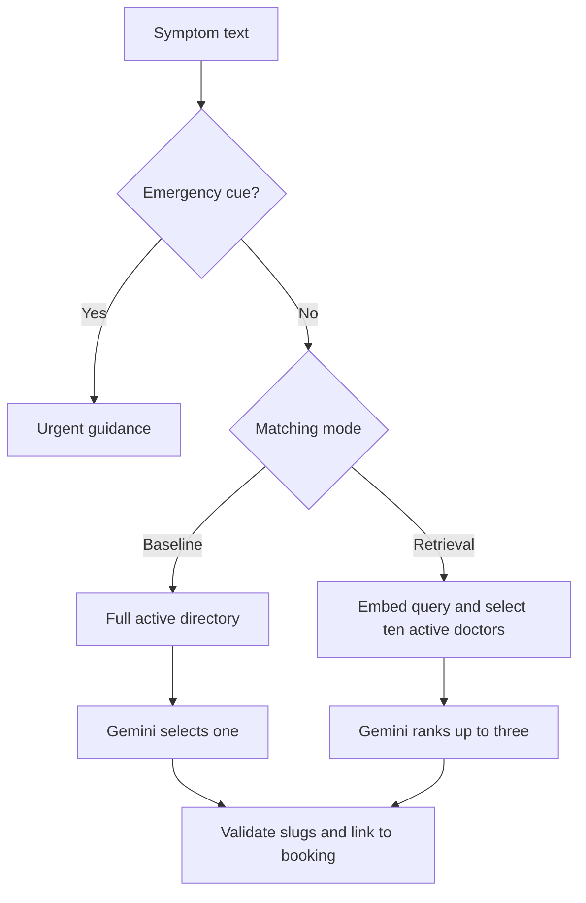

# FullHP

**FullHP** is a healthcare platform streamlining appointment booking and management for patients, doctors, and admins.

Initially built during **CodeWar 6.0** (under **Pyrokinesis 2025**) and further developed during **Google Solutions Challenge 2025**. The current maintainer develops and maintains the rebuilt backend and MedBot matching layer.

## Features

- Full end-to-end appointment booking and management
- Gemini powered medbot for preliminary diagnosis and specialist matching
- Patient view: appointment, medicine, and tests tracking
- Doctor view: weekly schedule and appointment management
- Full admin controls over all resources (patients, doctors, appointments)

## Tech Stack

- **Frontend**: React (Next.js), Tailwind CSS, shadcn/ui, Motion
- **Backend**: Next.js Route Handlers, Auth.js, Prisma, PostgreSQL
- **Tooling**: TypeScript, Zod, pnpm, Biome, Docker
- **AI Integration**: Google Gemini

## Credits

Currently being developed by: [Poran Dip](https://github.com/poran-dip)

Original Hackathon Team — **Cosmic Titans**:

- [Poran Dip](https://github.com/poran-dip)
- [Dikshyan Chakroborty](https://github.com/Dikshyan)
- [Rajdeep Choudhury](https://github.com/RajdeepChoudhury)
- [Hirok Jyoti Sarma](https://github.com/Hirak505)

## Local Setup

Prerequisites:

- Node 24+ (current LTS)
- PNPM 11+
- PostgreSQL
- Docker (recommended for production builds)

Clone the repositoy:

```bash
git clone https://github.com/poran-dip/fullhp.git
cd fullhp
```

Install dependencies and start dev server:

```bash
pnpm install
pnpm dev
```

Build for production:

```bash
docker compose up --build
```

Or, with pnpm:

```bash
pnpm build
pnpm start
```

## MedBot design

MedBot helps patients find a doctor to book. Emergency phrase checks run first and return urgent guidance without a booking link. This limited English-language screen can miss emergencies. It does not diagnose patients.



The default is the corrected full-directory baseline. To enable retrieval, deploy Prisma migrations, run `pnpm exec tsx --env-file=.env scripts/refresh-medbot.ts`, then set `MEDBOT_MODE=retrieval`. Schedule that refresh command regularly. Edits to department or specialization invalidate the stored vector immediately. New or changed profiles enter retrieval after refresh. With zero indexed active doctors the endpoint returns 503. Unset the flag to roll back matching.

PostgreSQL stores normalized 768-dimensional embeddings. Exact dot-product search takes linear time in the active roster and caps the rerank prompt at ten candidates. Within those ten, the prior is `0.95 × cosine + 0.05 × smoothedRating / 5`, where `smoothedRating = (count × average + 10 × 3.5) / (count + 10)`. Unrated doctors get the prior mean. Gemini considers specialty fit and returns only candidates from the supplied list.

### Evaluation

Run `pnpm exec tsx --env-file=.env eval/run.ts` with a Gemini API key. The 50 synthetic cases include 42 routine department labels and eight emergency cases. Each mode uses the same active roster. The retrieval benchmark computes the same exact similarity in memory. Its latency includes the query embedding and generation, and excludes database/network access to PostgreSQL. The runner generates 100 active synthetic doctors by default from the department and specialization catalog in `eval/roster.ts`. Set `EVAL_ROSTER_SIZE=18` to reproduce the historical roster or choose a larger positive integer for a scale test. Larger cohorts reuse clinical focuses with unique doctor IDs. The legacy copies setting selects a size of 18 times the multiplier when no explicit size is set. Use production-like data for deployment latency.

One run with 18 active fixture doctors used Gemini embeddings and Groq’s `openai/gpt-oss-120b` for ranking. Hits count routine queries where the expected department appeared at the indicated rank or better. Errors remain in the 42-query denominator. Prompt tokens are means over successful calls. Latency includes retry waits.

| Mode | Hit@1 | Hit@3 | Errors | Mean prompt tokens | p50 | p95 |
| --- | ---: | ---: | ---: | ---: | ---: | ---: |
| Full directory, one | 42/42 | N/A | 0 | 650.0 | 1.97 s | 6.30 s |
| Full directory, three | 41/42 | 41/42 | 1 | 688.9 | 5.15 s | 10.05 s |
| Retrieval, three | 40/42 | 40/42 | 2 | 490.0 | 6.32 s | 8.37 s |

For each query, the baseline sent all 18 active doctor profiles to the ranker. Retrieval sent the 10 closest profiles instead. Both modes requested up to three recommendations. Across successful calls, the smaller candidate list reduced the mean ranking prompt from 688.9 to 490.0 tokens (**28.9%**). The retrieved candidates included the expected department for **42/42** routine queries. All 40 completed retrieval-mode rankings placed that department first.

Offline fixture check: the emergency pre-check routed all eight urgent cases and left all 42 routine cases eligible for matching. These synthetic examples do not establish clinical sensitivity.

The runner also reports retrieval recall, emergency recall, failures and median latency. Keep the baseline as default until measured results justify promotion. Run offline regression tests with `pnpm exec tsx --test tests/*.test.mjs`.

Signed-in matching requests share a quota of ten per hour per account. Guests get five per hour per trusted Vercel address. On other hosts, unidentified guests share one fallback bucket. Emergency guidance bypasses these quotas.
